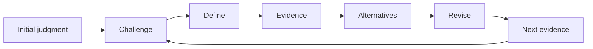

# Vincent's research-thinking method

[繁體中文](method.zh-TW.md)

## What changes through the loop

The object being improved is a **judgment**, not just a sentence. Begin with a question or interpretation and its reason. After inspecting evidence, preserve, narrow, replace, or withhold it. The visible record explains both the change and what would change it again.

The operational instructions live in [the workflow](../references/workflow.md); the table below is a reader's guide.

| Habit | Researcher's question | Observable product |
| --- | --- | --- |
| Challenge | What am I accepting too quickly? | First claim, reason, consequential premise |
| Define | What exactly needs an answer? | Focused question and distinction between construct and measure |
| Evidence | What was actually observed, and how strongly does it answer this? | Recoverable source ledger with support and limits |
| Alternatives | What else fits, and how would its predictions differ? | Credible explanations tied to discriminating evidence |
| Revise | What survives, changes, or remains undecidable? | Current judgment, reason, and next consequential check |

Next evidence feeds back to the relevant habit; the process is not a one-way funnel to a predetermined conclusion. A strong existing question may survive unchanged. A hypothesis can remain unresolved after careful analysis.

## Three useful reasoning forms

**Question refinement:** broad interest → precise uncertainty → observable construct → focused question. Do not mistake a new population, assay, or technology for an automatically important research gap.

**Evidence appraisal:** reported observation → measurement/design → scope of support → unsupported extension. Distinguish what a source says from what its design can establish.

**Explanation comparison:** H1 and a credible H2 → differing predictions → feasible discriminator → conditional revision. More supportive evidence is not necessarily informative if every explanation predicts it.

For qualitative or exploratory work, a discriminator may be a purposeful comparison, deviant case, contrasting account, or new source that changes the interpretation. Do not force all inquiries into a causal treatment-effect design. Feasibility and ethics still shape the next step.

## A map that carries evidence

The central question connects to **Problem, Evidence, Key unknown, Other explanations, Next evidence**. Use short nodes, stable IDs for important claims, and E/A/U tags. Definitions, source-status dimensions, edge labels, and the four-to-five-branch conversion have one authoritative home: [evidence and maps](../references/evidence-and-maps.md).

When reading a map, ask whether an edge represents an observation, an inference, or an unverified mechanism. A visually complete map can still contain an unsupported causal story. A sparse map that honestly marks unknowns is useful.

## Personal analysis and student guidance

In **analyze**, the assistant completes the supported reasoning and identifies what remains uncertain. It does not make the researcher answer a long interview when the available material already supports a useful analysis.

In **coach**, the learner first contributes a question and reason. The assistant asks one purposeful question, listens, then adjusts. The learner owns any revision and may reject feedback with a reason. A fictional demonstration must be labeled; it is not evidence of an actual learner's progress.

The games teach a transferable habit: write the first reason before the reveal, identify the assumption the result challenged, then choose a research check. See [course activities](../references/course-activities.md).

## Course activity design

Use **design-lesson** when preparing a lesson rather than talking to a learner. Define an observable thinking objective, choose an activity that exposes a relevant assumption, and plan individual first reasoning, evidence/reveal, peer challenge, learner-owned revision and an exit check. A complete teacher plan includes rules, timing, materials and expected artifacts; it does not invent future learner responses or treat agreement as success.

Start from the [120-minute lesson and 50-minute variant](../teaching/lesson-120.en.md), [six activity cards](../teaching/activity-cards.en.md), [lesson template](../templates/lesson-plan.en.md) and [learner worksheet](../templates/classroom-worksheet.en.md). The complete design contract lives in [lesson-design.md](../references/lesson-design.md). The new Prisoner's Dilemma protocol is labeled as an extension beyond the supplied slides.

## How optional thinking tools help

The course cycle stays stable. A tool is selected for a blind spot: undefined premise, representation/source mismatch, competing explanations, uncertain belief, incentives, or feasibility risk. [Adaptation rules](../references/thinking-tools.md) specify when to use each and what not to import from the software-oriented source. Do not use a large stack of frames as a substitute for evidence.

## A useful endpoint

You should be able to say:

> My original judgment was ____. The inspected evidence supports ____ within ____, but does not establish ____. The main remaining uncertainty is ____. I now keep/narrow/change/withhold ____ because ____. The next evidence is ____; if it shows ____, I would ____.

Use only the parts warranted by the material. This is a decision record, not a requirement to invent missing facts.

## Further reading and examples

The [serving-bowl example](../examples/serving-bowl.en.md) shows why source status and numerical labels matter. The [light-response example](../examples/light-response.en.md) distinguishes sufficiency from a complete mechanism. The [fictional nutrition example](../examples/nutrition.en.md) includes a complete analysis and a learner-first dialogue.

The [source map](../references/source-map.md) identifies course pages and research checks. The [rubric](../evals/rubric.md) supports teaching feedback and skill review; it is not a validated psychometric instrument or evidence of improved research outcomes.

## AI-assisted research: what remains your judgment?

Version 0.3.0 adds selected concepts from the attributed **Thinking Critically with AI** teaching pack: inspecting prompts, choosing a question framework, checking original sources, seeking contrary evidence, explaining without the AI display, and recording actual decisions. Tool claims are qualified rather than treated as guarantees; the pack is not evidence of this skill's effectiveness.

Use [AI judgment](../references/ai-judgment.md), [question frameworks](../references/question-frameworks.md), the [fictional example](../examples/ai-judgment.en.md), [50-minute lab](../teaching/ai-judgment-lab.en.md), and [AI research worksheet](../templates/ai-research-check.en.md) when those are the task. No new mode or online account is required. Researcher analysis remains immediately useful; a learner's first attempt and later explanation remain their own.
