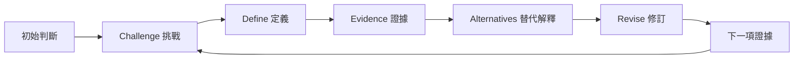

# Vincent 的研究思考方法

[English](method.en.md)

## 循環中改變的是什麼

這套方法處理的是**判斷如何被證據改變**。先保存一個問題或解釋，以及當時的理由；經過查核後，決定保留、限縮、改變或暫緩。紀錄要能說明這次為何修訂，以及什麼新證據會讓自己再修訂。

代理執行規則集中於 [workflow](../references/workflow.md)，下表供研究者與教師理解流程。

| 習慣 | 自問的問題 | 看得見的產物 |
| --- | --- | --- |
| Challenge | 我是否太快接受第一個答案？ | 原始主張、理由、最關鍵的前提 |
| Define | 真正需要回答的是什麼？ | 聚焦後問題，以及構念與測量的區別 |
| Evidence | 實際觀察了什麼，能支持到哪裡？ | 可回到原文的證據對照表與限制 |
| Alternatives | 還有什麼解釋，預測會如何不同？ | 合理解釋與能區分它們的證據 |
| Revise | 哪些判斷保留、改變，哪些仍無法決定？ | 目前判斷、修訂理由、下一項查核 |

新證據可回到任何相關步驟；流程不以預設結論為終點。原本清楚且有依據的題目可以保留，經過分析仍無法判定的問題也應誠實保留。

## 三種可重複使用的分析範式

**研究問題聚焦：**廣泛興趣 → 關鍵未知 → 可觀察的構念 → 可回答的問題。換族群、換 assay 或使用新技術，不自動構成重要研究空白。

**證據判讀：**來源報告 → 測量與設計 → 可支持的範圍 → 尚未支持的延伸。把「文獻這樣寫」與「設計足以支持」分開。

**解釋比較：**主要解釋與可信替代解釋 → 不同預測 → 可行的判別方式 → 條件式修訂。如果所有解釋都預測同一結果，再多相同方向的資料也未必增加判別力。

質性或探索性研究可利用對照經驗、負例、不同脈絡或新增來源改變詮釋，不必硬套介入／對照的因果格式。下一步仍須符合研究倫理與可行性。

## 讓 MindMap 承載證據

中央放一個研究問題，連到 **Problem、Evidence、Key unknown、Other explanations、Next evidence**。重要節點給 ID，再標 E/A/U。節點定義、來源狀態、關係線及四分枝到五分枝的對照，統一見 [evidence and maps](../references/evidence-and-maps.md)。

看圖時要追問：這條線是觀察、推論，還是未驗證的機制？看起來完整的圖仍可能隱藏不受支持的因果鏈；能誠實標出未知的簡圖也有研究價值。

## 個人研究與學生指導

**analyze** 直接完成有依據的分析，說明目前未知。已有材料可回答時，不把研究者帶進冗長訪談。

**coach** 先由學生提出問題與理由，再由 AI 每輪問一個會影響判斷的問題，依回答調整鷹架。學生決定是否接受回饋，也可提出理由後保留原題。虛構示範對話須明示，不得當成真實學習成效。

遊戲的共通做法是：先寫理由，再看結果，指出哪個假設受挑戰，最後連回自己的研究查核。活動與研究的對照見 [course activities](../references/course-activities.md)。

## 課程活動設計

備課時使用 **design-lesson**，與現場學生對話分開。先定義可觀察的思考目標，選能顯露相關假設的活動，再安排個人初始推理、證據／結果揭露、同儕挑戰、本人修訂及 exit check。教師完整教案包含規則、時間、材料與預期產物，但不預填未來學生回答，也不把同意教師當成成功。

可直接從 [120 分鐘課程及 50 分鐘變體](../teaching/lesson-120.zh-TW.md)、[六張活動卡](../teaching/activity-cards.zh-TW.md)、[備課範本](../templates/lesson-plan.zh-TW.md) 與 [個人學習單](../templates/classroom-worksheet.zh-TW.md) 開始；完整設計規則見 [lesson-design.md](../references/lesson-design.md)。新增 Prisoner's Dilemma 完整流程標為原教材之外的延伸。

## 思考工具如何加入

課程循環保持穩定；只有出現具體盲點時，才補入澄清前提、核對原始來源、競爭解釋、不確定性更新、誘因或可行性風險工具。[改寫規則](../references/thinking-tools.md) 說明每個工具的用途與界線；工具數量不能取代證據品質。

## 一個有用的完成狀態

> 我原本認為＿＿。核對到的證據在＿＿範圍內支持＿＿，但尚未證明＿＿。目前最重要的未知是＿＿。我現在保留／限縮／改變／暫緩＿＿，理由是＿＿。下一項需要的證據是＿＿；如果出現＿＿，我會＿＿。

只填有材料支持的部分。這是判斷紀錄，不是要求把缺少的內容編完整。

## 範例與評閱

[Serving-bowl 範例](../examples/serving-bowl.zh-TW.md) 示範來源狀態與數值標籤；[光反應範例](../examples/light-response.zh-TW.md) 區分充分性與完整機制；[虛構營養研究](../examples/nutrition.zh-TW.md) 包含完整分析與學生先思考對話。

[來源對照](../references/source-map.md) 保留教材頁碼與研究核對範圍。[rubric](../evals/rubric.md) 用於教學回饋及 Skill 評閱，尚非經驗證的心理計量工具，也不能用來宣稱研究能力已提升。

## AI 輔助研究：哪些判斷仍由你負責？

0.3.0 版納入已署名的 **Thinking Critically with AI** 教材概念：檢查提問、依問題選框架、回查原文、尋找相反證據、放下 AI 後解釋，以及記錄實際決定。工具宣稱保留適用界線；該教材並不是本技能成效的實證證據。

相關任務可用 [AI 判斷指引](../references/ai-judgment.md)、[問題框架](../references/question-frameworks.md)、[虛構示範](../examples/ai-judgment.zh-TW.md)、[50 分鐘實作課](../teaching/ai-judgment-lab.zh-TW.md) 與 [AI 研究學習單](../templates/ai-research-check.zh-TW.md)。不另增模式或線上帳號要求；研究分析仍直接完成可支持的工作，學生的初次嘗試與後續解釋仍由本人提供。
