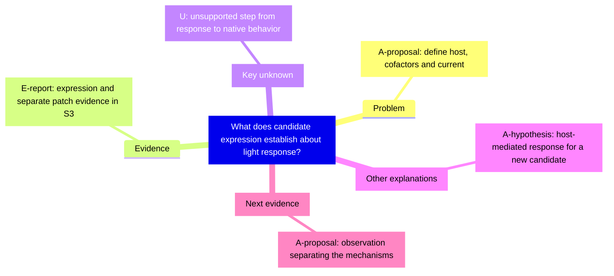

# Candidate protein and light response

This example adapts Week 5 pp. 2–7 to distinguish a research question, its method, and the reach of an inference. Source S3 is Nagel et al. (2003), DOI 10.1073/pnas.1936192100. See the [source map](../references/source-map.md) for the checked passages and access limitations.

## Challenge → Define

Starting interpretation: expressing a candidate protein produces a light response, so the complete mechanism of native phototaxis is solved.

The inference jumps from a response in a host system to a full explanation of native behavior. A better question is: under the stated host-cell and cofactor conditions, is expression sufficient for a light-evoked current, and what additional evidence distinguishes direct conductance from a host-mediated response?

Expression is the method. Sufficiency for a defined response is the question. Necessity in the native organism and the complete behavioral pathway are separate questions.

## Evidence and limits

S3 reports expression experiments in oocytes/mammalian cells and excised-patch observations supporting direct ChR2 channel function. These are distinct evidential steps. The latter is additional mechanism evidence, not something to infer from expression alone.

| ID | Label | Evidence boundary | Locator/checking |
| --- | --- | --- | --- |
| E1 | E-report | Expression-related light-evoked current under the tested conditions | S3 Abstract and Results, accessible indexed passages; C5 pp. 4–5 |
| E2 | E-report | Additional observations used to argue direct channel function | S3 Results, “ChR2 Itself Is the Cation Channel,” indexed passage checked |
| A1 | A-hypothesis | A newly studied candidate could act through a host component | Alternative for a new study, not a dismissal of S3's full evidence |
| U1 | U | Necessity and full causal pathway for native behavior in a new application | Not established merely by the expression contrast |

This is a focused check of the reasoning distinction, not a complete reanalysis of S3. No award or “first-ever” history claim is needed.

## Distinguish the explanations

For a **new hypothetical candidate**, compare expression/control and light/dark under appropriately controlled conditions. Those contrasts test whether the response depends on the candidate/light combination, but may not distinguish a direct channel from all host-mediated mechanisms.

If both mechanisms predict the same expression contrast, seek an additional feasible observation with different predictions. For example, observations in an appropriately isolated membrane preparation can address dependence on diffusible components. Whether a specific preparation is sufficient depends on its controls and residual components. “Purify and reconstitute it” is a proposed approach, not a claim that this was done in S3.

## Map and revision

**Narrow** the starting interpretation: sufficiency under specific conditions is informative, but does not alone settle necessity or the native behavioral pathway. In S3, assess the separate direct-channel evidence rather than pretending that the authors stopped at expression. For a new candidate, select a controlled discriminator and retain uncertainty until it is observed.

Coach opening: “Which claim can the expression/control comparison answer directly?” Wait for an answer before offering a revised conclusion.
