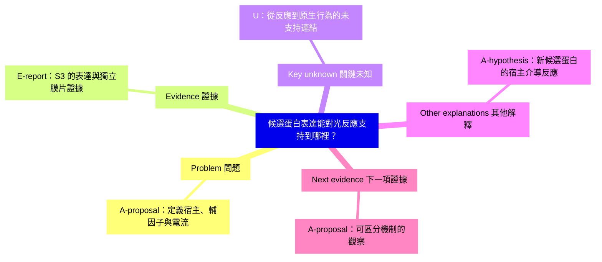

# 候選蛋白與光反應

本例依 Week 5 第 2–7 頁，區分研究問題、研究方法與推論範圍。S3 為 Nagel 等人 2003 年論文，DOI 10.1073/pnas.1936192100。核對段落及取得限制見 [來源對照](../references/source-map.md)。

## Challenge → Define

起始解釋：表達候選蛋白後有光反應，因此已解開原生生物趨光行為的完整機制。

這裡從宿主系統的反應，跳到了原生行為的完整解釋。較精確的問題是：在指定宿主細胞與輔因子條件下，候選蛋白的表達是否足以產生光誘發電流？哪些額外證據能區分直接導電與宿主介導的反應？

表達是方法；對特定反應的充分性是問題；原生生物中的必要性與完整行為路徑則是其他問題。

## 證據與界線

S3 報告卵母細胞／哺乳類細胞的表達實驗，並有支持直接 ChR2 通道功能的離體膜片觀察。這是不同層次的證據；不能只從表達結果推導後者。

| ID | 標記 | 證據範圍 | 位置與核對 |
| --- | --- | --- | --- |
| E1 | E-report | 試驗條件下，表達與光誘發電流的關係 | S3 Abstract／Results 可取得索引段落；C5 第 4–5 頁 |
| E2 | E-report | 用於支持直接通道功能的額外觀察 | S3 Results「ChR2 Itself Is the Cation Channel」索引段落已核對 |
| A1 | A-hypothesis | 新候選蛋白可能透過宿主組件產生反應 | 新研究的替代解釋，不是否認 S3 的完整證據 |
| U1 | U | 新應用中的必要性與原生行為完整因果路徑 | 不能只由表達比較確立 |

這是針對推論界線的核對，不是 S3 的全面重分析；不需要加入獎項或「首次發現」的科學史主張。

## 如何區分解釋

對**新的假設性候選蛋白**，先在適當控制下比較有／無表達與光／暗。這些比較檢驗反應是否依賴候選蛋白與光，但不一定區分直接通道與所有宿主介導機制。

如果兩種機制對表達比較有相同預測，下一步要找預測不同、且可行的額外觀察。例如，在適當分離的膜製備中觀察，可協助判斷是否依賴可擴散組件；是否足夠仍取決於控制與殘留組件。純化重組是可提出的研究方法，不冒充 S3 已做過的實驗。

## MindMap 與修訂

**限縮**起始解釋：特定條件下的充分性有意義，但本身不解決必要性與原生行為路徑。判讀 S3 時要評估其額外通道證據，不假裝作者只做到表達實驗；對新候選蛋白則選擇有控制的判別方式，在觀察前保留未知。

coach 第一問可為：「表達組與對照組的比較，能直接回答哪一項主張？」先等回答，再協助修訂。
