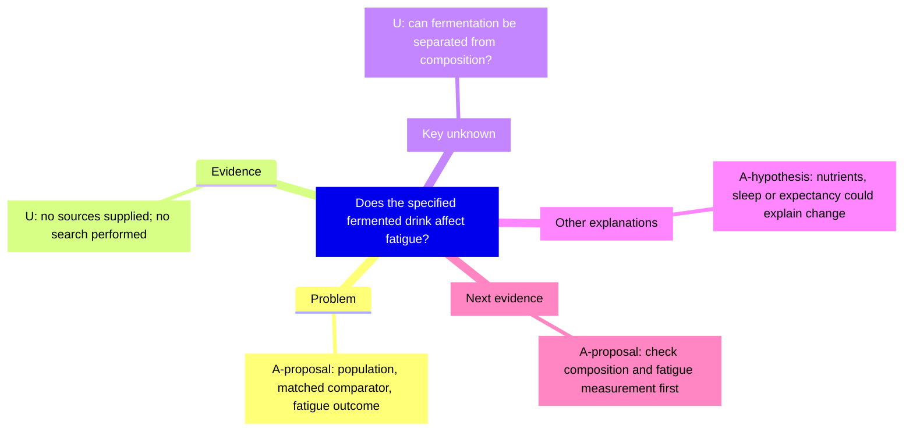

# Fictional nutrition question: analyze and coach

**Original hypothetical demonstration.** No empirical study, actual student, participant, result, or literature search is represented here. All study choices are A-proposals and evidence gaps are U. This illustrates reasoning, not an intervention recommendation.

## Analyze input

“I think a fermented soy drink improves fatigue in graduate students because fermentation is beneficial. Help me form a research question. I have not supplied papers or data.”

## Challenge and Define

The reason assumes that a general benefit of fermentation transfers to this product, this outcome and this population. Fatigue is not interchangeable with sleep duration, daytime sleepiness or athletic endurance.

**A-proposal focused question:** Among graduate students reporting fatigue, does a specified fermented soy drink, compared with a composition-matched non-fermented drink over a proposed six-week period, change a prespecified fatigue measure?

The product, period, measure and comparator need justification; they are not established choices or a confirmed novel gap. The original causal question is preserved, but now has observable requirements.

## Ledger

| ID | Statement | Label | Source/status | Consequence |
| --- | --- | --- | --- | --- |
| A1 | This product's fermentation-related components affect fatigue | A-hypothesis | Hypothetical premise, no evidence supplied | Needs product-specific and outcome-relevant evidence |
| A2 | Use a matched non-fermented drink and six weeks | A-proposal | Demonstration choice, not a protocol decision | Check composition, feasibility and time-course justification |
| U1 | Relevant prior studies and their limits | U | No search performed | Do not claim that the question is new |
| U2 | Suitable fatigue measure and smallest meaningful change | U | Not supplied | Establish construct/measurement fit before power planning |
| U3 | Product composition and feasible masking | U | Not supplied | Determine whether the intended contrast can be isolated |

There is no empirical E node to fill. An AI's proposed design is not evidence.

## MindMap

## Alternatives and discriminators

| Explanation | Different prediction | Discriminator proposed for planning |
| --- | --- | --- |
| Fermentation-related properties matter | Difference may remain with relevant nutritional composition held comparable | Verify product composition, then justify the contrast and design |
| Energy/nutrient differences matter | Difference follows composition rather than fermentation | Examine composition data and whether a matched comparator is possible |
| Sleep, caffeine, workload or expectancy matters | Fatigue changes with these factors or reporting conditions | Define timing, record relevant factors, assess masking and an appropriate allocation strategy |

No explanation is selected as true. Feasible comparisons may narrow rather than completely isolate the mechanism. A named measure or randomization does not itself solve every design problem.

## Revise and next evidence

**Narrow:** this is a testable product-specific hypothesis, not an established effect or demonstrated gap. First check whether the product/comparator composition can support the intended contrast and which fatigue measure fits the construct; in parallel locate relevant prior evidence. If composition cannot be matched, revise the question toward a product-comparison effect rather than fermentation alone. If the measurement targets sleepiness rather than fatigue, revise the outcome or the research question. A future null estimate would need its precision and design before being treated as equivalence.

Power, sample size, study authorization, and execution are not supplied by this reasoning example.

## Coach: fictional learner-first dialogue

This is a deliberately constructed transcript, not a record of real students. Each assistant turn asks one question. Future turns would depend on the learner's actual answer.

**Learner:** My question is whether fermented soy drinks improve fatigue. My reason is that fermented foods are beneficial.

**Assistant:** When you say fatigue, what observable experience or measure do you mean?

**Learner:** Persistent tiredness during study, rather than simply sleeping longer. I need a measure that fits that experience.

**Assistant:** Which evidence currently connects this particular drink to that fatigue outcome?

**Learner:** I do not have a paper yet; my reason is an assumption, so I will mark it A and the relevant literature U.

**Assistant:** What comparison would help separate a fermentation-related explanation from a nutritional-composition explanation?

**Learner:** I would first check whether a composition-matched non-fermented drink is feasible. I partly accept making my question more specific, but I have not chosen the final product or duration.

### Fictional learner's revision record

| Feedback | Decision | Learner's reason | Revision / next evidence |
| --- | --- | --- | --- |
| Define the outcome and isolate the comparison | Partly accepted | The construct needs a fitting measure, but product/time choices still lack support | Keep the provisional topic; find product composition and outcome-relevant literature |
| Treat the question as a confirmed gap | Not accepted | No literature search has been done | Mark novelty U; retain a search record when searching |

A real session ends on the actual learner's decision, not this scripted one. A teacher can later use the [coaching record](../templates/coach-session.en.md) without pre-filling learner responses.
