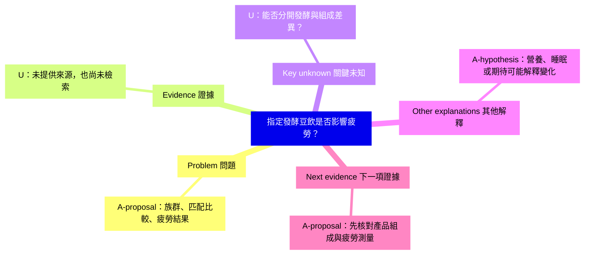

# 虛構營養研究：完整分析與學生指導

**原創假設性示範。**這裡沒有實際研究、學生、受試者、研究結果或已完成檢索。設計選擇全部是 A-proposal，缺少證據處標 U；範例不構成介入建議。

## analyze 輸入

「我認為發酵豆飲能改善研究生疲勞，因為發酵有益。請幫我形成研究問題。目前沒有提供論文或資料。」

## Challenge 與 Define

這個理由假定一般的發酵益處，能轉移到這項產品、這個結果與這個族群。疲勞也不等同睡眠時間、日間嗜睡或運動耐力。

**A-proposal 聚焦問題：**在自述疲勞的研究生中，指定發酵豆飲相較於營養組成匹配的未發酵飲品，於提議的六週內，是否改變事先指定的疲勞測量結果？

產品、期間、測量及比較都還需要依據；它們不是已確認的設計，也不是已證實的新穎研究空白。原始因果問題被保留，但其可觀察條件更清楚。

## 證據表

| ID | 敘述 | 標記 | 來源／狀態 | 對判斷的影響 |
| --- | --- | --- | --- | --- |
| A1 | 產品中的發酵相關成分影響疲勞 | A-hypothesis | 假設前提，未提供證據 | 需要產品特定且對應結果的證據 |
| A2 | 採組成匹配未發酵飲品與六週期間 | A-proposal | 示範選擇，不是 protocol 決定 | 查組成、可行性與時間依據 |
| U1 | 相關研究及其限制 | U | 尚未檢索 | 不能宣稱沒人做過 |
| U2 | 適合的疲勞測量與最小有意義變化 | U | 尚未提供 | 先處理構念與測量適配，再談 power |
| U3 | 產品組成與可行的盲法 | U | 尚未提供 | 判斷能否隔離預期比較 |

此時沒有可填入的實證 E 節點；AI 建議的設計不是證據。

## MindMap

## 替代解釋與判別

| 解釋 | 不同預測 | 規劃中的判別方式 |
| --- | --- | --- |
| 發酵相關特性影響疲勞 | 相關營養組成可比時，差異仍可能存在 | 先核對組成，再說明比較與設計 |
| 熱量或營養差異影響疲勞 | 差異跟隨組成，而非發酵本身 | 檢查組成資料與匹配比較的可行性 |
| 睡眠、咖啡因、工作量或期待影響結果 | 疲勞隨這些因素或回報條件改變 | 定義時點、記錄相關因素，評估盲法與適合的分派方式 |

目前不選定哪個解釋為真。可行比較可能只能限縮解釋，而無法完全隔離機制；有量表名稱或隨機分派，也不代表所有設計問題已解決。

## Revise 與下一項證據

**限縮：**這是產品特定、可檢驗的假說，尚非已確立的效果或研究空白。先查產品／對照組成是否能支持比較，以及哪種疲勞測量符合構念；同時找相關文獻。若組成無法匹配，應把問題改為產品比較效果，而非發酵的單獨效果；若測量針對嗜睡而非疲勞，則修訂結果或問題。未來即使未見顯著差異，也要先看估計精確度與設計，不能直接稱為等效。

這個思考範例不提供樣本數、研究授權或執行結果。

## coach：虛構的學生先思考對話

以下對話是刻意設計的示範，不是真實學生紀錄。每次 AI 只問一個問題；真實對話的下一步應依學生實際回答調整。

**學生：**我想問發酵豆飲能否改善疲勞，理由是發酵食品有益。

**AI：**你說的疲勞，具體指哪種可觀察經驗或測量？

**學生：**是讀書時持續覺得疲倦，不只是睡得更久；我要找符合這種經驗的測量。

**AI：**目前哪項證據把這項特定飲品連到這個疲勞結果？

**學生：**我還沒有論文，原來的理由是個假設，應標 A；相關文獻先標 U。

**AI：**哪種比較能協助區分發酵相關解釋與營養組成解釋？

**學生：**我要先確認營養組成匹配的未發酵飲品是否可行。我部分接受把題目聚焦，但還沒有決定最終產品與期間。

### 虛構學生的修訂紀錄

| 回饋 | 決定 | 學生理由 | 修訂／下一項證據 |
| --- | --- | --- | --- |
| 定義結果並釐清比較 | Partly accepted | 構念需要適合測量，但產品與期間仍缺依據 | 保留暫定主題，查產品組成與對應結果的文獻 |
| 把題目當成已確認的研究空白 | Not accepted | 尚未進行文獻搜尋 | 新穎性標 U，之後保留搜尋紀錄 |

真實指導要以學生自己的決定結束，不能套入這個腳本。教師可使用 [指導紀錄](../templates/coach-session.zh-TW.md)，但不要預填學生回答。
