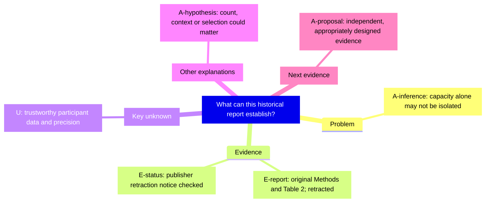

# Serving bowls: appraisal after retraction

**Historical teaching case; the original article was retracted.** Values below describe a published report and course excerpts, not validated participant data or dietary advice. Source records S1/S2 and course C3 are in the [source map](../references/source-map.md).

## Challenge and Define

Initial teaching claim: smaller serving bowls make everyone eat less.

Load-bearing assumptions: bowl capacity was isolated; snack-taking participants represent everyone offered food; a one-event difference establishes a general causal effect. The claim also needs to distinguish food served from food consumed.

Focused appraisal question: what can this report establish about bowl capacity and snack intake, given its design and later publication status?

## Evidence ledger

| ID | Report or check | Label | Locator / access and checking | Status / implication |
| --- | --- | --- | --- | --- |
| E1 | Methods describe 40 consenting people and allocation by alternation | E-report | S1 Methods; C3 pp. 20–22, accessible text/course excerpt checked | Retracted; alternation must not be relabeled randomization |
| E2 | Two 4-L bowls were contrasted with four 2-L bowls at different tables; 35 snack takers entered the primary analysis | E-report | S1 Methods; C3 pp. 21–22 | Retracted; capacity, count, context and inclusion cannot be collapsed into one factor |
| E3 | Displayed calorie-consumption summaries are 251 and 393 kcal, labeled medians in the course's table-footnote appraisal | E-report | S1 Table 2; C3 p. 23, table excerpt checked | Retracted; 393 − 251 = 142 is a difference of displayed medians, not a verified mean effect |
| E4 | The publisher issued a retraction notice | E-status | S2, notice checked | Original data validity was not assured; do not rely on the effect |
| U1 | Participant-level outcomes and an appropriate uncertainty interval | U | Not available in the supplied material | Do not reconstruct individual data or a confidence interval from a p-value |

The numerical and inclusion checks illustrate how labels and denominators affect interpretation. Even a faithful report extraction cannot repair its retraction. A metadata/status check is not raw-data verification.

## Map

## Alternatives and discriminators

| Explanation to test | Differing prediction | Proposed discriminator |
| --- | --- | --- |
| Capacity/visual cue matters | A contrast persists when count and presentation are held comparable | Independently test capacity with count fixed and suitable allocation |
| Count or display matters | A contrast appears when count changes with capacity held fixed | Compare presentation/count separately |
| Context, selection or group differences matter | Results change with allocation, table location or inclusion target | Define the estimand, record all relevant outcomes, and examine an independent design |

These are teaching hypotheses, not causes established by this report. Measured zero intake, missing intake, and an imputed sensitivity value are different quantities. Choose the inclusion target before selecting an analysis.

## Revise and choose next evidence

**Withhold the general effect claim.** The report cannot establish advice that smaller bowls make everyone eat less. Retraction does not show that bowl capacity has no effect either.

First seek independent evidence with a clear capacity contrast, measured intake and an explicit inclusion target. An independently replicated difference with adequate design/precision would support a bounded capacity-effect claim; a precisely small effect would limit it; wide uncertainty would leave it unresolved. A complete native mechanism would require further evidence.

Coach opening, if requested: “Which part of ‘smaller bowls make everyone eat less’ is directly measured here?” Wait for the learner's answer before the next question.
