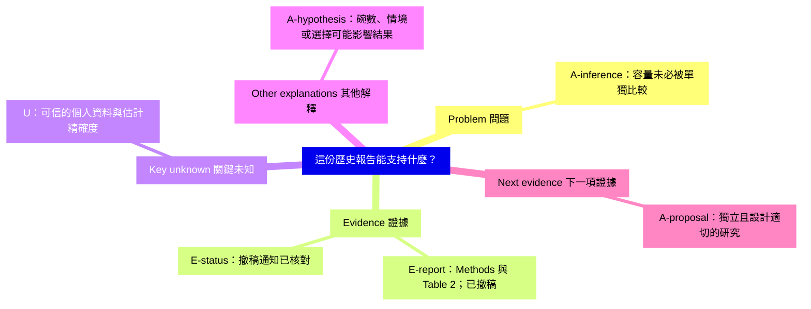

# Serving bowls：撤稿後如何修訂判斷

**這是已撤稿研究的歷史教學案例。**下列數值描述的是文獻與教材報告，不是已驗證的個人資料，也不是飲食建議。研究來源 S1／S2 與課程 C3 見 [來源對照](../references/source-map.md)。

## Challenge 與 Define

初始教學主張：使用較小的公共取餐碗，會讓每個人吃得更少。

這句話假定碗容量已被單獨比較、取餐者代表所有被提供食物的人，而且單一場合可推論普遍因果效果；也要先分清楚取走與實際吃下的食物。

聚焦後的判讀問題：考量研究設計與後續撤稿狀態，這份報告能對碗容量與零食攝取支持到哪裡？

## 證據對照

| ID | 報告或查核 | 標記 | 位置、取得與核對範圍 | 狀態與意義 |
| --- | --- | --- | --- | --- |
| E1 | Methods 報告 40 人同意參與，以交替方式分派 | E-report | S1 Methods；C3 第 20–22 頁，可取得文字及教材節錄已核對 | 已撤稿；不能把交替分派改稱隨機分派 |
| E2 | 不同桌比較兩個 4-L 碗與四個 2-L 碗，主要分析納入 35 位取餐者 | E-report | S1 Methods；C3 第 21–22 頁 | 已撤稿；容量、碗數、情境與納入方式不能合併成單一因素 |
| E3 | 攝取熱量顯示為 251 與 393 kcal，教材核對的表註標為 median | E-report | S1 Table 2；C3 第 23 頁，表格節錄已核對 | 已撤稿；142 是兩個顯示中位數的差，不是已驗證的平均效果 |
| E4 | 出版社發布撤稿通知 | E-status | S2，通知已核對 | 原始資料有效性無法獲得保證，不能依靠該效果作實質結論 |
| U1 | 個人層級結果與適當的不確定區間 | U | 提供材料無法取得 | 不從 p-value 反推個人資料或信賴區間 |

忠實擷取不等於資料有效性驗證。這裡用數值標籤與分析分母說明推論差異，不能以方法分析修復撤稿問題。

## MindMap

## 替代解釋與判別方式

| 待檢驗解釋 | 不同預測 | 提議的判別方式 |
| --- | --- | --- |
| 容量／視覺線索影響攝取 | 固定碗數與呈現方式後仍有差異 | 獨立設計容量比較與適當分派 |
| 碗數或擺設影響攝取 | 固定容量、改變碗數時出現差異 | 分開檢驗碗數與呈現 |
| 情境、選擇或群體差異影響結果 | 改變分派、位置或分析對象時結果改變 | 先定義 estimand、記錄相關結果，再用獨立設計評估 |

這些是教學假說，不是原研究已確認的原因。實測零攝取、缺失攝取量、敏感度分析填補值各不相同；不能先選方便的分析對象，再反過來決定研究問題。

## Revise 與下一項證據

**暫緩普遍效果主張。**不能用這份報告支持「小碗讓所有人少吃」，但撤稿本身也不證明碗容量完全沒有效果。

下一步先找獨立證據，確認容量比較、攝取測量與納入對象。若有設計適切且具精確度的獨立重現，才支持有限範圍的容量效果；若效果精確地接近很小，則限縮主張；若不確定性仍大，維持未知。完整機制仍需其他證據。

需要 coach 時，第一問可為：「『小碗讓每個人少吃』這句話中，哪一部分是這份研究直接測量的？」等待學生回答後再繼續。
