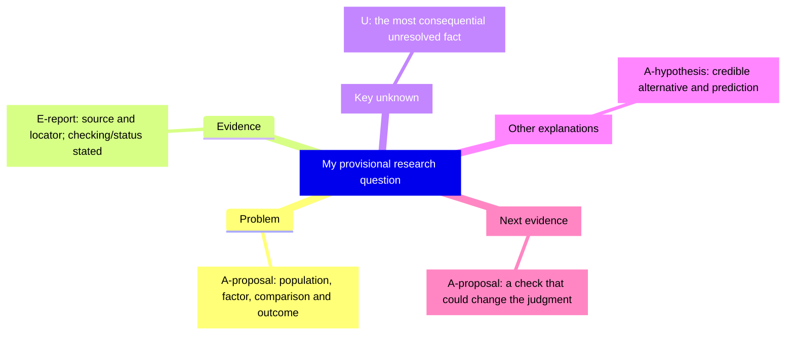
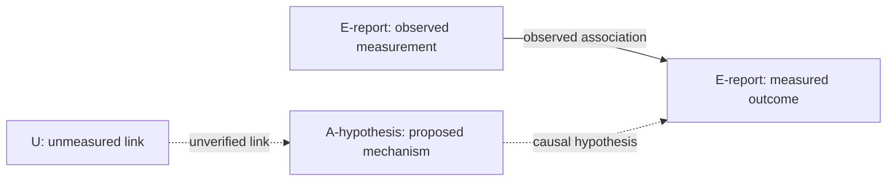
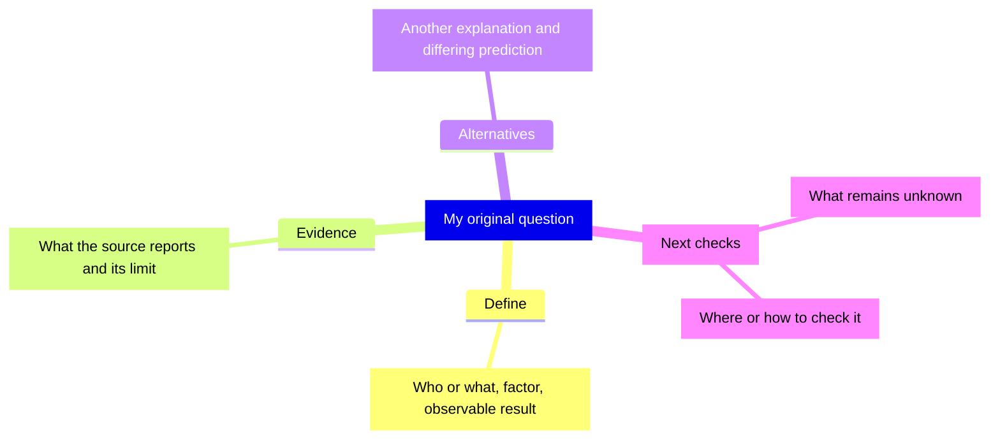

# Evidence-aware question map

Replace the quoted placeholders with the current question and short claims. The authoritative [map rules](../references/evidence-and-maps.md) define labels, evidence status, branch mapping, and edges.

## Formal five branches

The hierarchy groups ideas; it does not prove a causal chain.

## Label a consequential relationship separately

Add source IDs/status beside the diagram or in its ledger. A hypothetical example with no empirical data uses A/U labels instead of E-report.

## Four-branch entry exercise

When ready, split Next checks into Key unknown and Next evidence; rename Define to Problem and Alternatives to Other explanations. Normalize introductory [H] to A-hypothesis/proposal and [?] to U.
