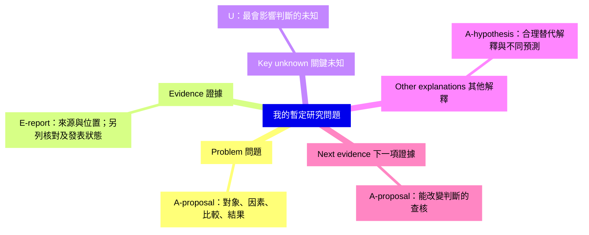
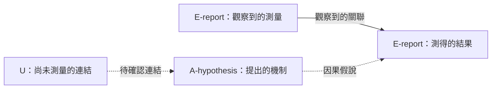
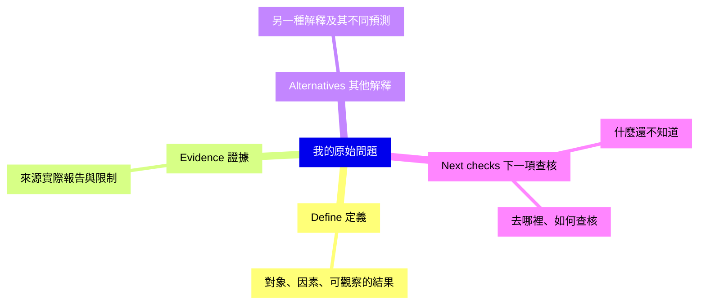

# 帶有證據標記的研究問題圖

將引號內的範例文字換成當前問題與短句。標記、來源狀態、關係線及分枝對照統一見 [map rules](../references/evidence-and-maps.md)。

## 正式五分枝

分枝只整理概念，不證明因果關係；真正的觀察、推論與提案仍要分別標示。

## 重要關係另畫並標示

圖旁附來源 ID、核對範圍與發表狀態，或連到證據表。完全假設性的情境以 A/U 取代 E-report，不偽裝成觀察結果。

## 四分枝入門練習

進階時，把 Next checks 分成 Key unknown 與 Next evidence；Define 對應 Problem，Alternatives 對應 Other explanations。入門標記 [H] 對應 A-hypothesis/proposal，[?] 對應 U。
